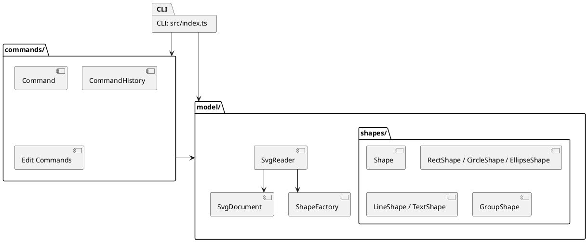

# SVG 编辑器 CLI：架构与过程记录

## 架构方案

### 模块划分

| 模块 | 职责 |
|---|---|
| `src/index.ts` | CLI 入口；读取用户命令、显示帮助和结果，并调用命令类或模型服务。文件读写目前也由入口执行。 |
| `src/commands/` | 定义 `Command` 接口、维护撤销/重做历史，并为创建、删除、移动、缩放、改属性、分组和调整层级顺序提供命令对象。 |
| `src/model/` | 保存画布、图形树和图形工厂；`SvgReader` 将 SVG 文本解析为模型，`SvgDocument.toSvg()` 将模型序列化为 SVG。 |
| `src/model/shapes/` | `Shape` 抽象基类及矩形、圆、椭圆、线、文字和分组模型。图形封装自己的几何属性、属性读写和 SVG 序列化。 |
| `doc/` | 架构说明、开发过程、一致性自查和质量保证记录。 |

### 设计模式

采用 Command模式封装图形编辑操作。创建、删除、移动、缩放、修改属性、分组和调整层级等操作都有对应的命令类，实现统一的 `Command` 接口，并提供 `execute()` 和 `undo()`。CLI 创建命令并交给 `CommandHistory` 执行；历史对象保存已执行和已撤销的命令，以支持撤销与重做。这样，命令输入、操作逻辑和历史管理彼此分开，新增操作时也可以通过新增命令类实现。

### 依赖方向规则

1. CLI 入口可以依赖命令层和模型层；命令层、模型层不得依赖 CLI。
2. 命令层依赖 `Command` 接口及模型对象，以执行并撤销模型变更；模型层不依赖具体命令。
3. `ShapeFactory` 可以依赖具体图形类；`SvgReader` 通过工厂构建图形，并通过 `SvgDocument` 组装文档。
4. 具体图形依赖 `Shape` 抽象；分组组合 `Shape` 子类，不能反向依赖 CLI 或命令层。

### 变化点假设

| 可能变化 | 当前处理 | 后续考虑 |
|---|---|---|
| 新增图形类型 | 新建 `Shape` 子类，在 `ShapeFactory` 注册，并补充 CLI 帮助及 SVG 读取映射。 | 把工厂类型映射改为注册机制，减少集中修改。 |
| 新增编辑命令 | 新建实现 `Command` 的类，并在 CLI 增加命令入口。 | 把命令名映射集中为命令注册表。 |
| 图形属性 | 属性由各图形封装；`SetShapeAttributeCommand` 通过统一接口撤销。 | 当属性增多时可引入属性元数据，统一校验和帮助信息。 |
| SVG 格式和元素 | `SvgReader` 负责读取，`SvgDocument` 与各图形负责输出。 | 当前读取器面向本项目支持的基本元素；转换矩阵、滤镜、渐变、外部资源及复杂文本结构尚未实现。 |
| UI 或存储方式 | 当前以 CLI 和本地文件为入口。 | 可增加 GUI/其他适配层，并把文件 I/O 从 CLI 入口移出。 |

## 过程记录

开发过程中，我先根据 AI 的建议整理了模块划分和依赖关系，再对照实际目录与代码进行核对，发现 `src/index.ts` 仍同时负责 CLI 交互和文件读写。因此，文档将文件 I/O 如实记录为当前入口的职责和后续改进项，没有把目标设计误写成现状。

实现撤销与重做时，我检查了命令对象是否都能保存执行前的状态，并通过 undo、redo 后的 show 和 tree 输出核对图形属性及层级是否恢复。对 SVG 读取部分，我也检查了文档描述与代码行为是否一致，特别是缺少 id 时的处理，以及遇到暂不支持的元素或 transform 时是否明确报错，避免文档声称支持实际尚未实现的功能。

整理架构图时，初版 PlantUML 的自动排版产生了跨越较长距离的弧线。我查看渲染结果后调整了连线方向与样式，并移除了表示包内包含关系的重复箭头；随后重新预览，确认依赖关系仍能表达清楚，连线也更规整。

## 一致性自查

1. 模块划分：当前目录包含 `commands/`、`model/`、`model/shapes/` 和 `doc/`，与上面的模块划分相符。文件系统 I/O 仍在 CLI 入口，已作为待改进项记录。
2. 依赖方向：命令类依赖模型，图形类依赖 `Shape`，CLI 调用命令与模型服务；`SvgReader` 调用 `ShapeFactory` 生成具体图形。可抽样检查 `import`，不应出现命令层或模型层反向导入 `src/index.ts` 的情况。

## 质量保证手段

我依据 `phase_cli_1.md` 编写了 `test/cli.test.mjs`，通过启动 CLI 子进程并输入命令，检查用户可见的输出和生成的 SVG 文件。测试覆盖画布初始化、六类图形创建、带空格文字、分组与嵌套、删除、属性修改、层级调整、撤销与重做、SVG 读写、缺失 `id` 的警告、非法命令处理及帮助信息。

运行 `npm test`，10 项自动化测试全部通过；运行 `npx tsc --noEmit`，TypeScript 类型检查通过。测试过程中发现树形输出未展开分组子图形、文字节点格式与需求示例不一致，以及未知属性错误信息不符合约定。我修正后重新运行了测试和类型检查，均通过。这些检查为当前实现提供了可重复的验证依据。

自动化测试尚未覆盖所有 SVG 语法、浏览器中的视觉效果及所有数值边界。最终提交前仍应按实际情况手工检查 SVG 浏览器预览，并核对 Git 状态与提交差异，避免把生成文件或 `node_modules` 加入提交。最终代码提交完成后创建并推送 `final` tag。

