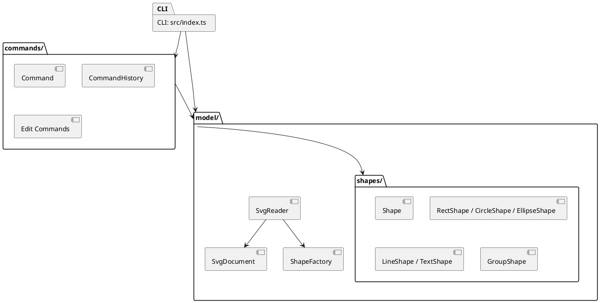

# SVG 编辑器 CLI：架构与过程记录

## 架构方案

### 模块划分

| 模块 | 职责 |
|---|---|
| `src/index.ts` | CLI 入口；读取用户命令、显示帮助和结果，并调用命令类或模型服务。文件读写目前也由入口执行。 |
| `src/commands/` | 定义 `Command` 接口、维护撤销/重做历史，并为创建、删除、移动、缩放、改属性、分组和调整层级顺序提供命令对象。 |
| `src/model/` | 保存画布、图形树和图形工厂；`SvgReader` 将 SVG 文本解析为模型，`SvgDocument.toSvg()` 将模型序列化为 SVG。 |
| `src/model/shapes/` | `Shape` 抽象基类及矩形、圆、椭圆、线、文字和分组模型。图形封装自己的几何属性、属性读写和 SVG 序列化。 |
| `doc/` | 架构说明、开发过程、一致性自查和质量保证记录。 |

### 设计模式

- **Command**：每个编辑动作由一个命令对象表示。`CommandHistory` 保存执行过的命令，并调用 `undo()` / `redo()`；文档读写和画布尺寸修改属于 I/O 操作，不进入编辑撤销栈。
- **Factory**：`ShapeFactory` 根据图形类型创建相应的 `Shape` 子类。CLI 创建命令和 SVG 读取器共用该工厂。
- **Composite**：`GroupShape` 也是 `Shape`，并持有子图形。移动和缩放等操作可以递归应用于组及其后代。

当前 CLI 命令名分派位于 `src/index.ts`，图形类型分派位于 `ShapeFactory`。按名称分派是本阶段允许的两个集中位置；若命令或图形类型继续增加，可分别改为命令注册表和可扩展工厂注册表。

### 依赖方向规则

1. CLI 入口可以依赖命令层和模型层；命令层、模型层不得依赖 CLI。
2. 命令层依赖 `Command` 接口及模型对象，以执行并撤销模型变更；模型层不依赖具体命令。
3. `ShapeFactory` 可以依赖具体图形类；`SvgReader` 通过工厂构建图形，并通过 `SvgDocument` 组装文档。
4. 具体图形依赖 `Shape` 抽象；分组组合 `Shape` 子类，不能反向依赖 CLI 或命令层。

**当前待改进项：**`src/index.ts` 仍同时负责命令交互和文件系统 I/O。若后续增加 GUI 或其他入口，应把文件存取移到独立的基础设施/服务模块，避免入口继续膨胀。

### 变化点假设

| 可能变化 | 当前处理 | 后续考虑 |
|---|---|---|
| 新增图形类型 | 新建 `Shape` 子类，在 `ShapeFactory` 注册，并补充 CLI 帮助及 SVG 读取映射。 | 把工厂类型映射改为注册机制，减少集中修改。 |
| 新增编辑命令 | 新建实现 `Command` 的类，并在 CLI 增加命令入口。 | 把命令名映射集中为命令注册表。 |
| 图形属性 | 属性由各图形封装；`SetShapeAttributeCommand` 通过统一接口撤销。 | 当属性增多时可引入属性元数据，统一校验和帮助信息。 |
| SVG 格式和元素 | `SvgReader` 负责读取，`SvgDocument` 与各图形负责输出。 | 当前读取器面向本项目支持的基本元素；转换矩阵、滤镜、渐变、外部资源及复杂文本结构尚未实现。 |
| UI 或存储方式 | 当前以 CLI 和本地文件为入口。 | 可增加 GUI/其他适配层，并把文件 I/O 从 CLI 入口移出。 |

## 过程记录

| 迭代 | 记录 |
|---|---|
| 项目初始化 | 先建立 TypeScript 项目和 Git 仓库，再逐项增加功能并推送，保留分步提交历史。 |
| 命令与撤销 | 把编辑操作逐步移入命令类，由 `CommandHistory` 管理撤销与重做；避免把全部状态修改塞进 CLI 回调。 |
| 图形类型扩展 | 从矩形扩展到圆、椭圆、线和文字，并通过 `ShapeFactory` 集中创建分派。 |
| SVG 文本处理 | 发现直接按空格拆分 CLI 输入无法读取带空格文字，因此增加双引号参数解析；SVG 文本和属性写出时转义 XML 特殊字符。 |
| 分组与层级 | 按组合结构处理分组；检查时发现文档代码调用了子项索引、插入和包含查询，但 `GroupShape` 缺少相应实现，随后补上这些方法和父子关系维护。 |
| SVG 读写 | 增加 SVG 序列化和读取器；读取器将标签对应的图形创建交给 `ShapeFactory`。读取缺少 `id` 的元素时生成标签名加序号，并输出警告。 |
| 项目范围调整 | 读取器目前拒绝 `transform` 和未支持的 SVG 元素，避免静默丢失这些内容；该限制需要在最终演示中说明。 |

## 一致性自查

1. **模块划分：**当前目录包含 `commands/`、`model/`、`model/shapes/` 和 `doc/`，与上面的模块划分相符。文件系统 I/O 仍在 CLI 入口，已作为待改进项记录。
2. **依赖方向：**命令类依赖模型，图形类依赖 `Shape`，CLI 调用命令与模型服务；`SvgReader` 调用 `ShapeFactory` 生成具体图形。可抽样检查 `import`，不应出现命令层或模型层反向导入 `src/index.ts` 的情况。

## 质量保证手段

本项目目前没有自动化测试脚本。交付前按以下清单进行手工检查，并记录实际结果：

1. 运行 `npm run cli`，分别创建 rect、circle、ellipse、line 和 text；用 `show` 检查属性。
2. 对叶子图形及分组执行 `move`、`scale`、`set`、`undo`、`redo`，检查 `tree` 和 `show` 的状态是否符合预期。
3. 检查 `group`、`ungroup`、`addto`、`front`、`back` 以及创建时的 `in <containerId>`；使用不存在的 id/容器确认失败时不会留下部分修改。
4. 用 `save demo.svg` 写出文件，在浏览器打开检查外观；再用 `read demo.svg` 读回，检查画布尺寸、图形树、文字及属性。
5. 准备缺少 `id` 的 SVG，确认读取时出现 `warning: assigned id ...`，再用 `tree` 确认生成的 id 唯一。
6. 提交前运行 `npx tsc --noEmit` 检查 TypeScript 类型，并检查 Git 状态和提交差异，确保只提交源代码与文档，不把生成的 SVG 或 `node_modules` 意外加入。

截至本记录编写时，自动化测试尚未添加；手工检查结果应在最终提交前按实际执行情况补记。最终代码提交完成后创建并推送 `final` tag。
